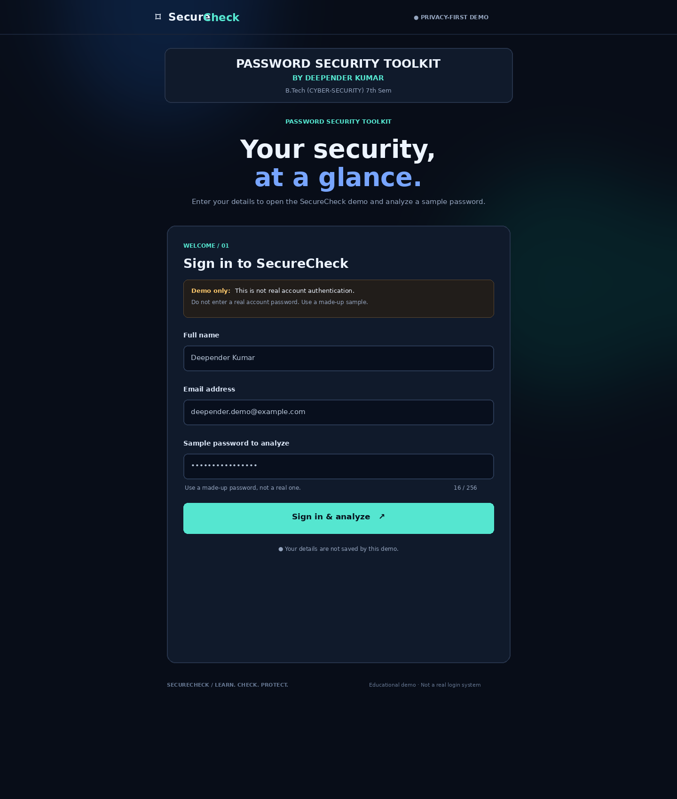
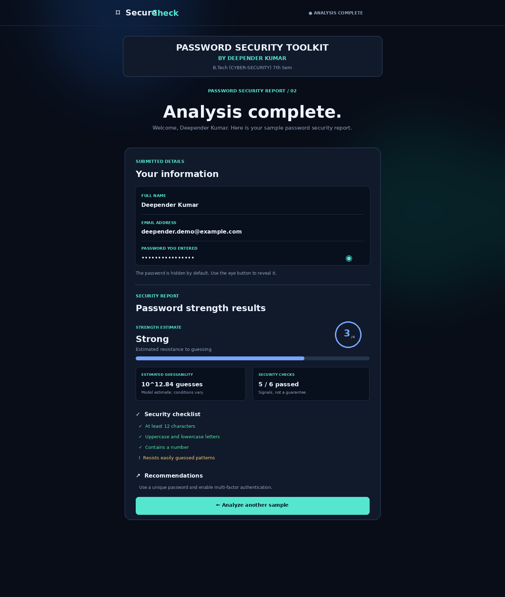

<div align="center">

# 🔐 CipherGuard Security Toolkit

### CipherGuard — Password Strength Analyzer

A modern, dark-themed Flask web app that evaluates a **sample password** and explains its strength with a clear, easy-to-read security report.

**Developed by Deepender Kumar**  
*B.Tech (Cyber-Security) · 7th Semester*

[🌐 **Live Demo**](https://Deepender789.pythonanywhere.com/) · [💻 GitHub Repository](https://github.com/deependerk789/CipherGuard)

[](https://www.python.org/)
[](https://flask.palletsprojects.com/)
[](https://github.com/dropbox/zxcvbn)
[](#-security--privacy-first)

</div>

---

## ✨ Overview

CipherGuard is an educational password-security project built with **Python, Flask, HTML, CSS, and JavaScript**. It uses the open-source **zxcvbn** estimator to assess how predictable a sample password may be and turns the result into a visual report.

The project has a two-page flow: enter demo details on the first page, then review the submitted details and password-strength report on the second page. A password visibility toggle lets users show or hide the password in the interface.

> ⚠️ **Demo only:** Do not enter a real password or credentials you use anywhere else. This is not an authentication system or a password manager.

## 🖥️ Screenshots

### 1. Welcome & sample-password form

The first page introduces CipherGuard and collects demo details before analysis.



### 2. Password analysis report

The results page displays the strength estimate, guessability estimate, checklist, and practical recommendations. The sample password is masked by default and can be toggled with the eye icon.



*Screenshots are illustrative previews of the interface. Use made-up sample data when running the app.*

## 🚀 Features

- **Password strength estimate** — score from 0 to 4 with a readable strength label.
- **Guessability estimate** — shows the model's estimated number of guesses on a logarithmic scale.
- **Security checklist** — reviews length, character variety, and resistance to common patterns.
- **Actionable feedback** — provides suggestions based on the zxcvbn analysis.
- **Two-page interface** — separate input and results screens.
- **Show/hide password control** — password fields are masked by default in the interface.
- **Responsive dark UI** — modern styling designed for desktop and smaller screens.
- **Basic defensive controls** — input validation, request-size limit, security-related response headers, and a health endpoint.
- **Automated tests** — basic route and validation tests are included.

## 🧰 Tech stack

| Technology | Purpose |
|---|---|
| Python | Application logic |
| Flask | Web framework and routes |
| zxcvbn | Password guessability and strength estimation |
| HTML & CSS | Page structure and dark responsive interface |
| JavaScript | Password visibility and small UI interactions |
| pytest | Basic automated tests |
| Gunicorn | Production WSGI server for deployment |

## 📁 Project structure

```text
CipherGuard_Two_Page_Updated/
├── app.py
├── requirements.txt
├── Procfile
├── render.yaml
├── .gitignore
├── README.md
├── templates/
│   ├── index.html
│   └── results.html
├── static/
│   ├── style.css
│   ├── login.js
│   └── result.js
├── screenshots/
│   ├── home.png
│   └── results.png
└── tests/
    └── test_app.py
```

## ⚙️ Run locally on Windows

### Prerequisites

- Python 3.12 or newer (use a currently supported stable release)
- Git
- VS Code or another code editor

### 1. Clone the repository

```powershell
git clone https://github.com/deependerk789/CipherGuard.git
cd CipherGuard
```

If you already have the project folder, open that folder in VS Code and use its terminal instead.

### 2. Create a virtual environment

```powershell
python -m venv venv
```

Activate it in PowerShell:

```powershell
.\venv\Scripts\Activate.ps1
```

If PowerShell blocks script activation, you can use this workaround for the **current terminal session only**:

```powershell
Set-ExecutionPolicy -Scope Process -ExecutionPolicy Bypass
.\venv\Scripts\Activate.ps1
```

Alternatively, skip activation and run the virtual environment's Python directly:

```powershell
.\venv\Scripts\python.exe -m pip install -r requirements.txt
.\venv\Scripts\python.exe app.py
```

### 3. Install dependencies

```powershell
python -m pip install --upgrade pip
python -m pip install -r requirements.txt
```

### 4. Start the app

```powershell
python app.py
```

Open **http://127.0.0.1:5000** in your browser.

### 5. Run the tests

```powershell
python -m pytest -q
```

## 🔌 API endpoints

### `POST /api/analyze`

Accepts a JSON body containing a sample password and returns a strength estimate, checks, feedback, and a disclaimer. The API response does not include the password itself.

Example request:

```json
{
  "password": "Example-Only-Password-938!"
}
```

Example with `curl`:

```bash
curl -X POST http://127.0.0.1:5000/api/analyze \
  -H "Content-Type: application/json" \
  -d '{"password":"Example-Only-Password-938!"}'
```

### `GET /health`

Returns a simple health status for local checks and hosting health checks.

## ☁️ Live deployment

**Live demo:** https://Deepender789.pythonanywhere.com/

This project is currently hosted on [PythonAnywhere](https://www.pythonanywhere.com/). The repository also contains `Procfile` and `render.yaml` from an earlier Render deployment configuration; they are not required to run the app locally or on PythonAnywhere.

To deploy your own copy, follow PythonAnywhere's current Flask web-app deployment instructions, configure the WSGI file to import `app` from this repository, install the packages from `requirements.txt` into the configured virtual environment, then reload the web app. Hosting plans and limits can change, so check the provider's current documentation.

Do not expose Flask's development server or enable debug mode in production. Test the public demo using made-up sample passwords only.

## 🛡️ Security & privacy first

This project is a learning demo—not a guarantee of security, a breach checker, a password manager, or a real login system.

- **Use sample passwords only.** Never enter a password used for email, banking, social media, work, or any real account.
- The form sends the sample password to the Flask server for analysis. The results page also includes the submitted value in its HTML so the demo can show it with masking. A masked field is not a security boundary.
- The application does not intentionally save submitted details to a database, but hosting infrastructure may process request contents. Review host logging and retention policies before publishing.
- The strength score is an estimate. It cannot protect against phishing, malware, password reuse, account recovery attacks, or a compromised service.
- For a real product, prefer client-side analysis if the password must never leave the browser, add appropriate rate limiting and security testing, and review the full deployment architecture.

## 🗺️ Possible future improvements

- Perform strength analysis entirely in the browser.
- Add accessibility and mobile-device testing.
- Add stronger automated tests and continuous integration.
- Improve deployment hardening and rate limiting.
- Add a privacy-preserving breached-password lookup only if designed and reviewed carefully.

## 👨‍💻 Developer

**Deepender Kumar**  
B.Tech (Cyber-Security), 7th Semester

---

<div align="center">

Built as an educational cybersecurity project. **Learn. Check. Protect.**

</div>


## CipherGuard feature update
This version includes a browser-based secure password generator, a password breach checker using the Have I Been Pwned range API, and a downloadable security checklist report. See `INSTALL.md` for setup notes.


## Interactive CipherGuard Guide

Click the glowing **GUIDE** button in the bottom-right corner to open the built-in helper. It offers guided tours for password analysis, password generation, breach checking, the security dashboard, and privacy. Tours include progress, Back/Next/Finish controls, and links to relevant pages. You can also type a basic question. This is a rule-based guide, not an AI model, and it never fills or submits password forms.


## Visual experience update

- Dedicated **Password Generator** page at `/password-generator`; the generator is opened with a button from the results page instead of appearing inline.
- **GuardBot** floating robot assistant with guided tours for the analyzer, generator, breach checker, dashboard, and privacy basics.
- Persistent **dark/light mode** switch (stored locally in the browser).
- 3D tilt effects on tool cards and an enhanced dashboard visual. Dashboard percentage graphics are illustrative, not live security measurements.

Run locally with `python app.py`, then open `http://127.0.0.1:5000/`. Test each route before deploying.


## Interactive experience
- **3D cursor follower:** a glowing depth-style orb follows the mouse on desktop while retaining the normal cursor.
- **Animated page transitions:** internal links and valid form submissions show a short 3D navigation animation.
- **Pointing robot guide:** guided tour steps highlight the related button or input and place a pointing-hand marker beside it.
- **Accessibility:** touch devices avoid the custom cursor, and reduced-motion preferences disable most motion.
